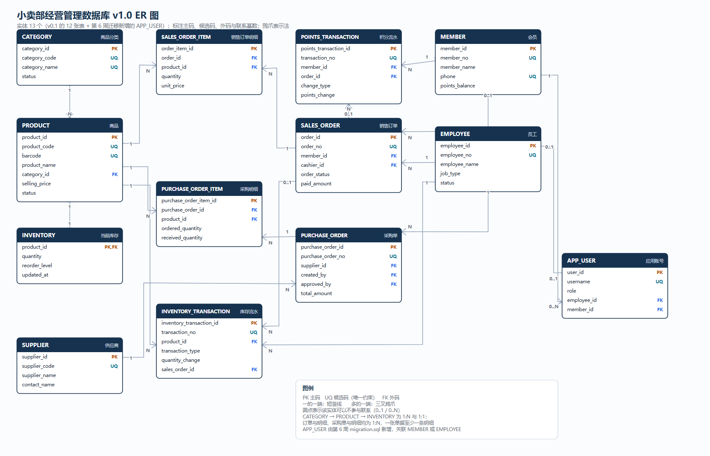
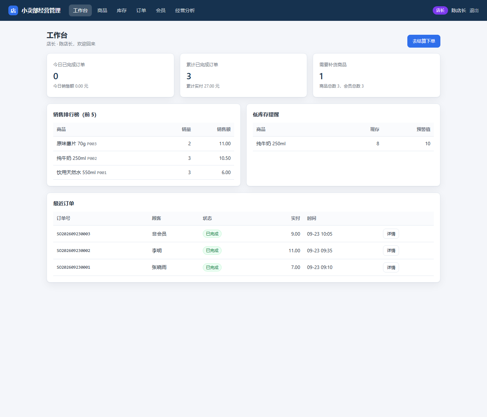

# 小卖部经营管理数据库课程项目

## 1. 项目范围

本项目以一家线下单门店小卖部为经营场景，围绕商品销售和库存补货建立数据库原型，并在第二阶段把它扩展为可运行的 Web 应用。核心闭环为：商品维护、顾客购买、订单与明细留存、库存扣减、会员积分更新、低库存发现、采购补货和库存增加。

进度概览：

- 第 1—4 周：完成数据库 v0.1（需求分析、关系设计、建表与 CRUD、查询/视图/约束/角色）；
- 第 5 周：从 v0.1 反推 ER 模型，形成实体、联系、基数和参与约束清单；
- 第 6 周：函数依赖与规范化分析，编写 `migration.sql` 与 `regression.sql`，迁移到 v1.0；
- 第 7—9 周：在 v1.0 之上实现分层的 Web 应用（登录、商品、库存、订单、订单明细、角色界面、事务与统一异常处理）。

## 2. 业务角色

项目包含顾客、会员、店员（收银员）、库存管理员（理货员）、店长和供应商。会员只能访问本人资料、积分和订单；店员负责销售结算；库存管理员负责入库与盘点；店长负责关键维护、审批和经营分析；供应商只参与外部供货协作。

Web 应用提供四个登录角色：顾客、店员、库存管理员、店长。

详细说明见[角色与职能清单](docs/角色与职能清单.md)。

## 3. 业务流程

顾客选购商品后，由店员录入商品并校验库存。顾客完成支付后，系统生成订单和订单明细，扣减库存，并在会员交易中记录积分变化。库存低于预警值时，库存管理员整理采购需求，店长审批，供应商到货后办理入库。

v1.0 应用里的两条下单路径：

1. **门店结算**：店员下单即完成（`COMPLETED`），同一事务内写订单、明细、扣库存、写流水、结算积分；
2. **顾客线上下单**：订单为 `PENDING`，不扣库存；店员确认收款时才扣库存并结算积分。

详细流程、业务规则和异常处理见[业务流程](docs/业务流程.md)。

## 4. 数据边界

进入数据库的信息包括商品、库存、订单、订单明细、会员、积分流水、员工、供应商、采购单和库存流水。支付账号、身份证号、监控录像、员工工资、复杂促销、多门店调拨等内容不属于本项目范围。

v1.0 新增的 `app_user` 只保存登录名、口令摘要、显示名、角色和员工/会员外码，不保存明文口令，也不保存任何敏感个人信息。

详细边界和理由见[数据边界清单](docs/数据边界清单.md)。

## 5. 第一周交付物

- [业务流程](docs/业务流程.md)
- [角色与职能清单](docs/角色与职能清单.md)
- [数据边界清单](docs/数据边界清单.md)
- [组内分工](docs/组内分工.md)
- [AI 使用记录](ai_log.md)

## 6. 第二周关系设计

第二周将业务对象转换为 12 个关系模式：商品分类、商品、当前库存、会员、员工、供应商、销售订单、销售订单明细、积分流水、采购单、采购单明细和库存流水。

- [关系模式与数据字典](docs/关系模式与数据字典.md)：包含表清单、字段类型、空值、默认值、域、主码、候选码、外码及表间联系；文末附 v1.0 增补说明。
- [样例元组](docs/样例元组.md)：包含相互引用一致的教学样例数据和一致性核对。

## 7. 第五周 ER 模型

第五周从 v0.1 反推 ER 模型，共 13 个实体（含第 6 周新增的应用账号），18 条联系，标注基数与参与约束。

- [ER 模型与 ER 图](docs/ER模型与ER图.md)：表示法、实体清单、联系清单、参与约束的落地方式、与表结构的对照。
- [业务规则与映射清单](docs/业务规则映射清单.md)：26 条业务规则，标明基数、对应外码与实现方式（约束 / 代码 / 人工）。
- [v0.1 问题清单](docs/v0.1问题清单.md)：15 项问题的证据、影响、改进方向与结论。
- ER 图源文件：`docs/er_diagram.svg`；导出图：`result/week5_01_er_diagram.png`；生成脚本：`tools/generate_er_diagram.py`。



## 8. 第六周规范化与迁移

- [函数依赖与规范化分析](docs/函数依赖与规范化分析.md)：逐表候选码、函数依赖、更新异常、1NF—BCNF 判断、无损连接与反规范化取舍。
- [迁移与回归说明](docs/迁移与回归说明.md)：变更清单、执行顺序、失败恢复、迁移前后对比、23 项回归结果。
- 脚本：[migration.sql](sql/migration.sql)、[regression.sql](sql/regression.sql)。

结论：12 张既有表已满足 3NF/BCNF，迁移只做新增——`app_user` 表、3 个应用视图、2 个角色、5 个应用账号和 7 个索引，既有表结构、约束与样例数据完全不变。

## 9. 第七至九周 Web 应用

技术栈：Python 3.12 + Flask 3.1 + pyodbc 5.x + SQL Server 17。

分层：页面层（`app/web/`、`app/templates/`）→ 业务层（`app/services/`）→ 数据访问层（`app/db/`）→ 数据库层。

- [应用设计与实现说明](docs/应用设计与实现说明.md)：分层职责、一次查询/一次修改经过哪些层、事务边界、权限矩阵、错误码表、日志与安全措施。
- [应用操作手册](docs/应用操作手册.md)：环境、安装、配置、启动、演示账号、各角色操作步骤、常见问题。
- [应用测试报告](docs/应用测试报告.md)：34 项自动化用例与 9 张界面截图说明。
- [第七至九周复现说明](docs/第七至九周复现说明.md)：从零复现的完整步骤。

应用截图（店长工作台）：



## 10. 目录结构

```text
database-lab/
├─ README.md
├─ ai_log.md
├─ requirements.txt
├─ .env.example
├─ run.py                     应用启动入口
├─ app/
│  ├─ __init__.py            应用组装与统一异常处理
│  ├─ config.py              配置（环境变量 + .env）
│  ├─ errors.py              错误类型与错误码
│  ├─ logging_setup.py       日志格式与滚动文件
│  ├─ security.py            口令摘要、会话、角色守卫
│  ├─ web/                   页面层：pages.py（页面路由）、api.py（JSON 接口）
│  ├─ services/              业务层：登录、商品、库存、订单、会员、报表、校验
│  ├─ db/                    数据访问层：连接、事务、异常翻译、各 DAO
│  ├─ templates/             页面模板
│  └─ static/                样式与前端脚本
├─ tests/
│  └─ test_app.py            应用测试脚本（34 项）
├─ tools/
│  └─ generate_er_diagram.py ER 图生成脚本
├─ docs/
│  ├─ 业务流程.md
│  ├─ 角色与职能清单.md
│  ├─ 数据边界清单.md
│  ├─ 关系模式与数据字典.md
│  ├─ 样例元组.md
│  ├─ 组内分工.md
│  ├─ 第三周复现说明.md
│  ├─ 第四周复现说明.md
│  ├─ ER模型与ER图.md
│  ├─ er_diagram.svg
│  ├─ 业务规则映射清单.md
│  ├─ v0.1问题清单.md
│  ├─ 函数依赖与规范化分析.md
│  ├─ 迁移与回归说明.md
│  ├─ 应用设计与实现说明.md
│  ├─ 应用操作手册.md
│  ├─ 应用测试报告.md
│  ├─ 第七至九周复现说明.md
│  ├─ 阶段报告.md            （v0.1 阶段报告）
│  └─ 阶段报告_v1.0.md       （第 5—9 周阶段报告）
├─ sql/
│  ├─ 00_create_database.sql
│  ├─ 01_create_tables.sql
│  ├─ 02_add_constraints.sql
│  ├─ 03_insert_sample_data.sql
│  ├─ 04_crud.sql
│  ├─ query.sql
│  ├─ view.sql
│  ├─ constraint.sql
│  ├─ role.sql
│  ├─ v01_acceptance.sql
│  ├─ migration.sql          v0.1 → v1.0 迁移
│  └─ regression.sql         迁移后回归检查
└─ result/
   ├─ README.md
   ├─ week3_*.png            第三周证据
   ├─ week4_*.png            第四周证据
   ├─ week5_01_er_diagram.png
   ├─ week6_01_migration_output.txt
   ├─ week6_02_regression_output.txt
   ├─ week7_01_login.png … week7_09_member_forbidden.png
   └─ week7_10_app_test_output.txt
```

## 11. 设计约定

1. 数据库管理系统使用 SQL Server，字段类型按 SQL Server 设计。
2. 表名和字段名统一使用小写英文加下划线。
3. 内部主码使用整数，业务编号使用唯一字符串。
4. 金额使用精确小数，状态使用明确枚举域。
5. 样例姓名、电话和交易均为教学用虚构数据。
6. 应用中的 SQL 只出现在 `app/db/`，且一律参数化。
7. 应用连接不使 sa，按登录角色切换到最小权限的应用账号。
8. 如果后续改变表或字段，必须同步更新数据字典、样例数据、迁移脚本和 AI 使用记录。

## 12. 当前进度

- [x] 第一周：需求分析
- [x] 第二周：关系模式、数据字典和样例元组
- [x] 第三周：数据库、12 张表、约束、样例数据和 CRUD 已在 SQL Server 中验证
- [x] 第四周：8 组查询、4 个视图、8 个约束测试、6 个权限测试和 v0.1 集中验收已在 SQL Server 中验证
- [x] 第五周：ER 模型、ER 图、业务规则映射清单和 v0.1 问题清单
- [x] 第六周：函数依赖与规范化分析、`migration.sql`、`regression.sql`，23 项回归全部通过
- [x] 第七至九周：分层 Web 应用、四种角色、事务与统一异常处理，34 项自动化测试全部通过
- [ ] 阶段报告：由组员根据现有材料整理为 Word 终稿

## 13. 快速开始

### 13.1 只需要数据库

在 SSMS 中从空数据库依次执行：

```text
00_create_database.sql
01_create_tables.sql
02_add_constraints.sql
03_insert_sample_data.sql
04_crud.sql
query.sql
view.sql
constraint.sql
role.sql
v01_acceptance.sql        ← 显示“v0.1 验收通过”
migration.sql             ← 迁移到 v1.0
regression.sql            ← 显示“v1.0 回归通过”
```

### 13.2 运行 Web 应用

```bash
cd database-lab
python -m pip install -r requirements.txt
copy .env.example .env             # 按本机情况修改 DB_SERVER
python run.py
```

浏览器打开 `http://127.0.0.1:5000`，演示账号：

| 用户名 | 初始口令 | 角色 |
|---|---|---|
| `manager01` | `Manager@2026` | 店长 |
| `cashier01` | `Cashier@2026` | 店员 |
| `stock01` | `Stock@2026` | 库存管理员 |
| `member01` | `Member@2026` | 顾客 |

运行测试：

```bash
python tests/test_app.py -v
```

详细步骤见[第七至九周复现说明](docs/第七至九周复现说明.md)与[应用操作手册](docs/应用操作手册.md)。

## 14. 运行证据

| 阶段 | 证据 |
|---|---|
| 第三周 | `result/week3_02`—`week3_06` 截图 |
| 第四周 | `result/week4_01`—`week4_05` 截图 |
| 第五周 | `result/week5_01_er_diagram.png` |
| 第六周 | `result/week6_01_migration_output.txt`、`result/week6_02_regression_output.txt` |
| 第七至九周 | `result/week7_01`—`week7_09` 界面截图、`result/week7_10_app_test_output.txt` |

说明见[result 目录说明](result/README.md)。

第三周、第四周的具体操作见[第三周复现说明](docs/第三周复现说明.md)与[第四周复现说明](docs/第四周复现说明.md)；第 5—9 周的完整过程见[阶段报告 v1.0](docs/阶段报告_v1.0.md)。
