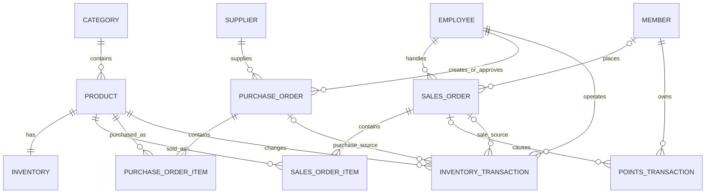

# 小卖部关系模式与数据字典

## 1. 设计目标

本设计把第一周确定的业务对象转换为可实现的关系模式，覆盖商品、库存、订单、订单明细、会员、员工、供应商、采购补货、积分和库存流水。字段类型按 SQL Server 设计，但本周只完成逻辑设计，不创建数据库、不编写 SQL。

## 2. 命名与类型约定

1. 表名和字段名使用小写英文加下划线，避免空格和中文标识符。
2. 表的内部主码使用整数；对外展示和人工录入的编号另设唯一编码。
3. 中文名称使用 `NVARCHAR`，固定格式的编码、状态和电话号码使用 `VARCHAR`。
4. 金额使用 `DECIMAL(10,2)`，不使用浮点数。
5. 时间使用 `DATETIME2(0)`，只需要日期时使用 `DATE`。
6. 状态字段均限定在明确的枚举域内，不使用含义不清的数字状态码。
7. `PK` 表示主码，`UQ` 表示候选码对应的唯一约束，`FK` 表示外码。

## 3. 表清单

| 序号 | 关系模式 | 业务对象 | 主要用途 |
|---|---|---|---|
| 1 | `category` | 商品分类 | 对商品进行分类管理和统计 |
| 2 | `product` | 商品 | 保存商品基础信息和当前销售价格 |
| 3 | `inventory` | 当前库存 | 保存每种商品的现存数量和预警值 |
| 4 | `member` | 会员 | 保存会员身份和当前积分余额 |
| 5 | `employee` | 员工 | 保存员工资料和业务岗位 |
| 6 | `supplier` | 供应商 | 保存补货协作方的基本信息 |
| 7 | `sales_order` | 销售订单 | 保存一笔交易的整体信息 |
| 8 | `sales_order_item` | 销售订单明细 | 保存订单内的商品、数量和成交单价 |
| 9 | `points_transaction` | 会员积分流水 | 记录积分增加或扣减的来源和结果 |
| 10 | `purchase_order` | 采购单 | 保存补货申请、审批和到货状态 |
| 11 | `purchase_order_item` | 采购单明细 | 保存采购商品、订购数量、实收数量和进价 |
| 12 | `inventory_transaction` | 库存流水 | 记录销售出库、采购入库和盘点调整 |

## 4. 关系模式总览

```text
CATEGORY(category_id, category_code, category_name, status, created_at)
PRODUCT(product_id, product_code, barcode, product_name, category_id,
        unit, selling_price, status, created_at)
INVENTORY(product_id, quantity, reorder_level, updated_at)
MEMBER(member_id, member_no, member_name, phone, points_balance,
       registered_at, status, remark)
EMPLOYEE(employee_id, employee_no, employee_name, phone, job_type,
         hire_date, status, created_at)
SUPPLIER(supplier_id, supplier_code, supplier_name, contact_name, phone,
         address, status, created_at)
SALES_ORDER(order_id, order_no, member_id, cashier_id, order_time,
            order_status, payment_method, original_amount,
            discount_amount, paid_amount)
SALES_ORDER_ITEM(order_item_id, order_id, product_id, quantity, unit_price)
POINTS_TRANSACTION(points_transaction_id, transaction_no, member_id,
                   order_id, change_type, points_change, balance_after,
                   occurred_at, remark)
PURCHASE_ORDER(purchase_order_id, purchase_order_no, supplier_id,
               created_by, approved_by, order_date, order_status,
               total_amount, approved_at)
PURCHASE_ORDER_ITEM(purchase_order_item_id, purchase_order_id, product_id,
                    ordered_quantity, received_quantity, purchase_unit_price)
INVENTORY_TRANSACTION(inventory_transaction_id, transaction_no, product_id,
                      transaction_type, quantity_change, sales_order_id,
                      purchase_order_id, operator_id, occurred_at, remark)
```

## 5. 字段定义

### 5.1 category 商品分类表

| 字段 | 类型 | 空值 | 默认值或域 | 码 | 含义 |
|---|---|---|---|---|---|
| `category_id` | `INT` | 否 | 正整数，自增 | PK | 分类内部编号 |
| `category_code` | `VARCHAR(20)` | 否 | 大写英文或数字 | UQ | 分类业务编码 |
| `category_name` | `NVARCHAR(50)` | 否 | 非空字符串 | UQ | 分类名称 |
| `status` | `VARCHAR(10)` | 否 | `ACTIVE`、`INACTIVE`；默认 `ACTIVE` |  | 分类状态 |
| `created_at` | `DATETIME2(0)` | 否 | 默认当前时间 |  | 创建时间 |

**码说明：** `category_id` 作为稳定的内部主码；`category_code` 和 `category_name` 在当前单门店范围内也能唯一标识分类，因此是候选码。

### 5.2 product 商品表

| 字段 | 类型 | 空值 | 默认值或域 | 码 | 含义 |
|---|---|---|---|---|---|
| `product_id` | `INT` | 否 | 正整数，自增 | PK | 商品内部编号 |
| `product_code` | `VARCHAR(20)` | 否 | 非空业务编码 | UQ | 门店商品编码 |
| `barcode` | `VARCHAR(32)` | 否 | 数字或合法条码字符 | UQ | 商品条码 |
| `product_name` | `NVARCHAR(100)` | 否 | 非空字符串 |  | 商品名称及规格 |
| `category_id` | `INT` | 否 | 必须引用已存在的分类 | FK → `category.category_id` | 所属分类 |
| `unit` | `NVARCHAR(10)` | 否 | 如瓶、盒、袋、件 |  | 销售计量单位 |
| `selling_price` | `DECIMAL(10,2)` | 否 | 大于或等于 0 |  | 当前销售单价 |
| `status` | `VARCHAR(12)` | 否 | `ACTIVE`、`INACTIVE`；默认 `ACTIVE` |  | 是否可售 |
| `created_at` | `DATETIME2(0)` | 否 | 默认当前时间 |  | 创建时间 |

**码说明：** `product_id` 是主码；`product_code` 和 `barcode` 都可唯一识别商品，是候选码。订单明细仍保存成交单价，避免商品调价后改变历史订单。

### 5.3 inventory 当前库存表

| 字段 | 类型 | 空值 | 默认值或域 | 码 | 含义 |
|---|---|---|---|---|---|
| `product_id` | `INT` | 否 | 必须引用商品 | PK；FK → `product.product_id` | 对应商品，一种商品仅一条当前库存 |
| `quantity` | `INT` | 否 | 大于或等于 0；默认 0 |  | 当前可用数量 |
| `reorder_level` | `INT` | 否 | 大于或等于 0；默认 10 |  | 补货预警值 |
| `updated_at` | `DATETIME2(0)` | 否 | 默认当前时间 |  | 最近更新时间 |

**码说明：** `product_id` 同时是主码和外码，表示商品与当前库存是一对一关系。库存低于或等于预警值时进入补货检查。

### 5.4 member 会员表

| 字段 | 类型 | 空值 | 默认值或域 | 码 | 含义 |
|---|---|---|---|---|---|
| `member_id` | `INT` | 否 | 正整数，自增 | PK | 会员内部编号 |
| `member_no` | `VARCHAR(20)` | 否 | 非空会员号 | UQ | 对外使用的会员号 |
| `member_name` | `NVARCHAR(50)` | 否 | 非空字符串 |  | 会员姓名 |
| `phone` | `VARCHAR(20)` | 否 | 合法联系电话 | UQ | 会员登录或识别手机号 |
| `points_balance` | `INT` | 否 | 大于或等于 0；默认 0 |  | 当前积分余额 |
| `registered_at` | `DATETIME2(0)` | 否 | 默认当前时间 |  | 注册时间 |
| `status` | `VARCHAR(10)` | 否 | `ACTIVE`、`INACTIVE`；默认 `ACTIVE` |  | 会员状态 |
| `remark` | `NVARCHAR(200)` | 是 | 默认空值 |  | 必要备注 |

**码说明：** `member_id` 是主码；`member_no` 和 `phone` 均能唯一定位会员，是候选码。积分余额用于快速查询，积分流水用于解释余额变化。

### 5.5 employee 员工表

| 字段 | 类型 | 空值 | 默认值或域 | 码 | 含义 |
|---|---|---|---|---|---|
| `employee_id` | `INT` | 否 | 正整数，自增 | PK | 员工内部编号 |
| `employee_no` | `VARCHAR(20)` | 否 | 非空工号 | UQ | 员工业务编号 |
| `employee_name` | `NVARCHAR(50)` | 否 | 非空字符串 |  | 员工姓名 |
| `phone` | `VARCHAR(20)` | 否 | 合法联系电话 | UQ | 员工联系电话 |
| `job_type` | `VARCHAR(20)` | 否 | `MANAGER`、`CASHIER`、`INVENTORY` |  | 业务岗位 |
| `hire_date` | `DATE` | 否 | 合法日期 |  | 入职日期 |
| `status` | `VARCHAR(10)` | 否 | `ACTIVE`、`INACTIVE`；默认 `ACTIVE` |  | 在职或停用状态 |
| `created_at` | `DATETIME2(0)` | 否 | 默认当前时间 |  | 记录创建时间 |

**码说明：** `employee_id` 是主码；工号和手机号分别是候选码。`job_type` 表示业务岗位，第四周的数据库角色另行创建，二者不能混为一谈。

### 5.6 supplier 供应商表

| 字段 | 类型 | 空值 | 默认值或域 | 码 | 含义 |
|---|---|---|---|---|---|
| `supplier_id` | `INT` | 否 | 正整数，自增 | PK | 供应商内部编号 |
| `supplier_code` | `VARCHAR(20)` | 否 | 非空业务编码 | UQ | 供应商编码 |
| `supplier_name` | `NVARCHAR(100)` | 否 | 非空字符串 |  | 供应商名称 |
| `contact_name` | `NVARCHAR(50)` | 否 | 非空字符串 |  | 联系人 |
| `phone` | `VARCHAR(20)` | 否 | 合法联系电话 |  | 联系电话 |
| `address` | `NVARCHAR(200)` | 是 | 默认空值 |  | 配送或办公地址 |
| `status` | `VARCHAR(10)` | 否 | `ACTIVE`、`INACTIVE`；默认 `ACTIVE` |  | 合作状态 |
| `created_at` | `DATETIME2(0)` | 否 | 默认当前时间 |  | 创建时间 |

**码说明：** `supplier_id` 是主码，`supplier_code` 是候选码。供应商名称可能因分公司或重名而重复，因此不作为候选码。

### 5.7 sales_order 销售订单表

| 字段 | 类型 | 空值 | 默认值或域 | 码 | 含义 |
|---|---|---|---|---|---|
| `order_id` | `BIGINT` | 否 | 正整数，自增 | PK | 订单内部编号 |
| `order_no` | `VARCHAR(30)` | 否 | 非空订单号 | UQ | 对外展示的订单号 |
| `member_id` | `INT` | 是 | 会员交易引用会员；非会员为空 | FK → `member.member_id` | 下单会员 |
| `cashier_id` | `INT` | 否 | 必须引用员工 | FK → `employee.employee_id` | 经办收银员 |
| `order_time` | `DATETIME2(0)` | 否 | 默认当前时间 |  | 下单或结算时间 |
| `order_status` | `VARCHAR(12)` | 否 | `PENDING`、`COMPLETED`、`CANCELLED`；默认 `PENDING` |  | 订单状态 |
| `payment_method` | `VARCHAR(12)` | 是 | `CASH`、`MOBILE`、`CARD`；待支付或取消可为空 |  | 支付方式 |
| `original_amount` | `DECIMAL(10,2)` | 否 | 大于或等于 0 |  | 优惠前商品金额 |
| `discount_amount` | `DECIMAL(10,2)` | 否 | 0 至原始金额；默认 0 |  | 优惠或积分抵扣金额 |
| `paid_amount` | `DECIMAL(10,2)` | 否 | 待支付或取消时为 0；完成时等于原始金额减抵扣 |  | 实付金额 |

**码说明：** `order_id` 是主码，`order_no` 是候选码。`member_id` 允许为空，以支持非会员购物；`cashier_id` 必须存在，以便追溯经办人。待支付或取消订单不记录支付方式且实付金额为 0，只有完成订单才记录支付方式和实际付款金额。

### 5.8 sales_order_item 销售订单明细表

| 字段 | 类型 | 空值 | 默认值或域 | 码 | 含义 |
|---|---|---|---|---|---|
| `order_item_id` | `BIGINT` | 否 | 正整数，自增 | PK | 订单明细内部编号 |
| `order_id` | `BIGINT` | 否 | 必须引用订单 | FK → `sales_order.order_id` | 所属订单 |
| `product_id` | `INT` | 否 | 必须引用商品 | FK → `product.product_id` | 所购商品 |
| `quantity` | `INT` | 否 | 大于 0 |  | 购买数量 |
| `unit_price` | `DECIMAL(10,2)` | 否 | 大于或等于 0 |  | 交易发生时的成交单价 |

**候选码：** `(order_id, product_id)` 设置为联合唯一，表示同一商品在同一订单中合并为一条明细。明细金额由 `quantity × unit_price` 查询计算，避免重复存储。

### 5.9 points_transaction 会员积分流水表

| 字段 | 类型 | 空值 | 默认值或域 | 码 | 含义 |
|---|---|---|---|---|---|
| `points_transaction_id` | `BIGINT` | 否 | 正整数，自增 | PK | 积分流水内部编号 |
| `transaction_no` | `VARCHAR(30)` | 否 | 非空流水号 | UQ | 积分流水业务编号 |
| `member_id` | `INT` | 否 | 必须引用会员 | FK → `member.member_id` | 对应会员 |
| `order_id` | `BIGINT` | 是 | 订单产生的积分引用订单；人工调整可为空 | FK → `sales_order.order_id` | 来源订单 |
| `change_type` | `VARCHAR(12)` | 否 | `EARN`、`REDEEM`、`ADJUST` |  | 积分变动类型 |
| `points_change` | `INT` | 否 | 非 0；增加为正、扣减为负 |  | 本次积分变动值 |
| `balance_after` | `INT` | 否 | 大于或等于 0 |  | 变动后的积分余额 |
| `occurred_at` | `DATETIME2(0)` | 否 | 默认当前时间 |  | 发生时间 |
| `remark` | `NVARCHAR(200)` | 是 | 默认空值 |  | 变动说明 |

**码说明：** 内部流水编号为主码，`transaction_no` 为候选码。订单可对应一条抵扣流水和一条获得积分流水，因此不能把 `order_id` 单独设置为唯一。

### 5.10 purchase_order 采购单表

| 字段 | 类型 | 空值 | 默认值或域 | 码 | 含义 |
|---|---|---|---|---|---|
| `purchase_order_id` | `BIGINT` | 否 | 正整数，自增 | PK | 采购单内部编号 |
| `purchase_order_no` | `VARCHAR(30)` | 否 | 非空采购单号 | UQ | 对外使用的采购单号 |
| `supplier_id` | `INT` | 否 | 必须引用供应商 | FK → `supplier.supplier_id` | 供货方 |
| `created_by` | `INT` | 否 | 必须引用员工 | FK → `employee.employee_id` | 创建采购单的员工 |
| `approved_by` | `INT` | 是 | 审批后引用员工 | FK → `employee.employee_id` | 审批人 |
| `order_date` | `DATE` | 否 | 默认当前日期 |  | 采购日期 |
| `order_status` | `VARCHAR(12)` | 否 | `DRAFT`、`APPROVED`、`RECEIVED`、`CANCELLED`；默认 `DRAFT` |  | 采购状态 |
| `total_amount` | `DECIMAL(10,2)` | 否 | 大于或等于 0；默认 0 |  | 采购总金额 |
| `approved_at` | `DATETIME2(0)` | 是 | 未审批为空 |  | 审批时间 |

**码说明：** 内部编号是主码，`purchase_order_no` 是候选码。草稿未审批时，`approved_by` 和 `approved_at` 允许为空。

### 5.11 purchase_order_item 采购单明细表

| 字段 | 类型 | 空值 | 默认值或域 | 码 | 含义 |
|---|---|---|---|---|---|
| `purchase_order_item_id` | `BIGINT` | 否 | 正整数，自增 | PK | 采购明细内部编号 |
| `purchase_order_id` | `BIGINT` | 否 | 必须引用采购单 | FK → `purchase_order.purchase_order_id` | 所属采购单 |
| `product_id` | `INT` | 否 | 必须引用商品 | FK → `product.product_id` | 采购商品 |
| `ordered_quantity` | `INT` | 否 | 大于 0 |  | 订购数量 |
| `received_quantity` | `INT` | 否 | 0 至订购数量；默认 0 |  | 实际收货数量 |
| `purchase_unit_price` | `DECIMAL(10,2)` | 否 | 大于或等于 0 |  | 采购单价 |

**候选码：** `(purchase_order_id, product_id)` 设置为联合唯一，同一采购单内同一商品只出现一次。明细金额由数量和进价计算。

### 5.12 inventory_transaction 库存流水表

| 字段 | 类型 | 空值 | 默认值或域 | 码 | 含义 |
|---|---|---|---|---|---|
| `inventory_transaction_id` | `BIGINT` | 否 | 正整数，自增 | PK | 库存流水内部编号 |
| `transaction_no` | `VARCHAR(30)` | 否 | 非空流水号 | UQ | 库存流水业务编号 |
| `product_id` | `INT` | 否 | 必须引用商品 | FK → `product.product_id` | 变动商品 |
| `transaction_type` | `VARCHAR(20)` | 否 | `SALE_OUT`、`PURCHASE_IN`、`COUNT_GAIN`、`COUNT_LOSS` |  | 变动类型 |
| `quantity_change` | `INT` | 否 | 非 0；入库为正、出库为负 |  | 库存数量变化 |
| `sales_order_id` | `BIGINT` | 是 | 销售出库时引用订单 | FK → `sales_order.order_id` | 来源销售订单 |
| `purchase_order_id` | `BIGINT` | 是 | 采购入库时引用采购单 | FK → `purchase_order.purchase_order_id` | 来源采购单 |
| `operator_id` | `INT` | 否 | 必须引用员工 | FK → `employee.employee_id` | 经办员工 |
| `occurred_at` | `DATETIME2(0)` | 否 | 默认当前时间 |  | 发生时间 |
| `remark` | `NVARCHAR(200)` | 是 | 默认空值 |  | 盘点原因等说明 |

**业务约束：** `SALE_OUT` 必须是负数且关联销售订单；`PURCHASE_IN` 必须是正数且关联采购单；盘盈盘亏不关联销售或采购单。`inventory.quantity` 是当前结果，库存流水是变化依据，两者应在同一事务中更新。

## 6. 表间联系

| 主表 | 从表 | 基数 | 联系含义 |
|---|---|---|---|
| `category` | `product` | 1:N | 一个分类包含多个商品 |
| `product` | `inventory` | 1:1 | 每个商品有一条当前库存记录 |
| `member` | `sales_order` | 1:N，可选 | 会员可有多笔订单，非会员订单不关联会员 |
| `employee` | `sales_order` | 1:N | 一个收银员可经办多笔订单 |
| `sales_order` | `sales_order_item` | 1:N | 一笔订单至少包含一条明细 |
| `product` | `sales_order_item` | 1:N | 一个商品可出现在多笔订单中 |
| `member` | `points_transaction` | 1:N | 一个会员有多条积分流水 |
| `sales_order` | `points_transaction` | 1:N，可选 | 一笔会员订单可产生抵扣和获得积分流水 |
| `supplier` | `purchase_order` | 1:N | 一个供应商可对应多张采购单 |
| `employee` | `purchase_order` | 1:N | 员工创建或审批采购单 |
| `purchase_order` | `purchase_order_item` | 1:N | 一张采购单包含多条商品明细 |
| `product` | `purchase_order_item` | 1:N | 一个商品可被多次采购 |
| `product` | `inventory_transaction` | 1:N | 一个商品对应多次库存变化 |
| `sales_order` 或 `purchase_order` | `inventory_transaction` | 1:N，可选 | 销售出库或采购入库形成库存流水 |

## 7. 关系图



## 8. 设计检查

1. 每张表只描述一种业务对象或一种明确联系，重复组已拆分为订单明细和采购明细。
2. 商品当前售价与订单成交单价分开，历史交易不会因调价而改变。
3. 订单、采购单分别与各自明细形成一对多关系，满足一张单据包含多种商品的需求。
4. 当前积分与积分流水并存、当前库存与库存流水并存；前者便于快速读取，后者用于审计，后续必须用事务保持一致。
5. 所有外码均引用主表主码，创建表时先创建被引用表，删除时按相反顺序处理。
6. 敏感支付凭证、身份证号等不在字段设计中，符合第一周的数据边界。
